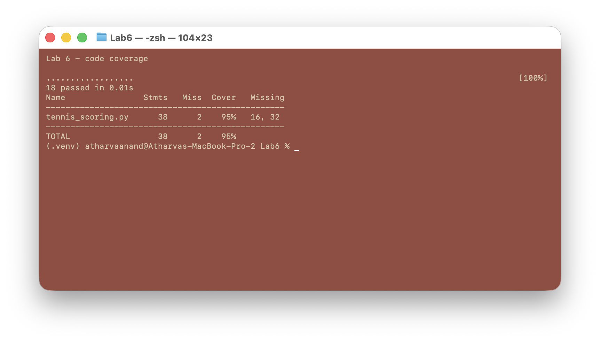

# Lab 6: Code and Branch Coverage Analysis

Student: Atharva Anand (PES1UG24CS092)

Assigned starter: [SETAPESU26/L6_L7_34_tennis_scoring](https://github.com/SETAPESU26/L6_L7_34_tennis_scoring)

The application under test is the assigned `tennis_scoring.py`. Its scoring logic is unchanged. The supplied `test_tennis_scoring.py` is retained for reference.

## Setup

From this folder, create and activate a Python virtual environment, then install the dependencies:

```sh
python3 -m venv .venv
. .venv/bin/activate
python -m pip install -r requirements.txt
```

## Code coverage stage

Run `./run_line_coverage.sh` after activating the environment. This runs only `CodeCoverageTest_tennis_scoring_application.py` and reports coverage for the application, not the test code.

The starter's two tests covered 37% of lines. The expanded suite has 18 passing cases and covers **36 of 38 statements (95%)**. The remaining lines are the `advantage B` result and the 7-6 set result for B. They are addressed in the branch coverage stage.


