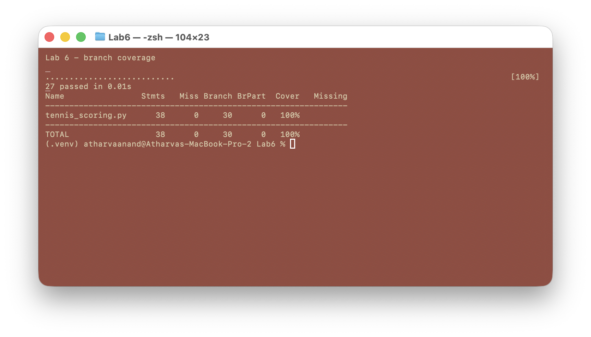

# Lab 6: Code and Branch Coverage Analysis

Student: Atharva Anand (PES1UG24CS092)

Assigned starter: [SETAPESU26/L6_L7_34_tennis_scoring](https://github.com/SETAPESU26/L6_L7_34_tennis_scoring)

[Download the four-page coverage report (PDF)](Lab6_Coverage_Report_PES1UG24CS092.pdf). It includes the final terminal screenshots, coverage analysis, and complete listings of both maintained Python test files.

The application under test is the assigned `tennis_scoring.py`. Its scoring logic is unchanged. The supplied `test_tennis_scoring.py` is retained for reference.

## Setup

From this folder, create and activate a Python virtual environment, then install the dependencies:

```sh
python3 -m venv .venv
. .venv/bin/activate
python -m pip install -r requirements.txt
```

## Code coverage stage

Run `./run_line_coverage.sh` after activating the environment. This runs only `CodeCoverageTest_tennis_scoring_application.py` and reports coverage for the application, not the test code.

The starter's two tests covered 37% of lines. The expanded suite has 18 passing cases and covers **36 of 38 statements (95%)**. The remaining lines are the `advantage B` result and the 7-6 set result for B. They are addressed in the branch coverage stage.


## Branch coverage stage

Run `./run_branch_coverage.sh` after activating the environment. This runs only `BranchCoverageTest_tennis_scoring_application.py` with `coverage --branch` enabled. Its 27 passing cases cover **all 38 statements and all 30 branches (100%)**. Added cases exercise advantage B, a 6-7 set, both negative-point inputs, equality at deuce, the one-point and two-point game margins, and set and match boundaries.



## Coverage analysis

| Suite | Line coverage | Branch coverage |
| --- | ---: | ---: |
| Supplied starter (2 tests) | 37% | 32% |
| Code coverage stage (18 tests) | 95% | 94% |
| Branch coverage stage (27 tests) | 100% | 100% |

Line coverage counts executed statements. Branch coverage also counts the alternate outcomes of decisions. The first stage leaves two output paths untested even though nearly every statement runs. The second stage explicitly exercises those paths and adjacent boundaries. The percentages come from `coverage report -m` for `tennis_scoring.py` only. They do not establish the correctness of every possible tennis score, but show that every measured statement and branch in this starter implementation was executed.

Both added test files are discoverable with `pytest` via `pytest.ini`. The scripts keep each stage's measurement separate.
